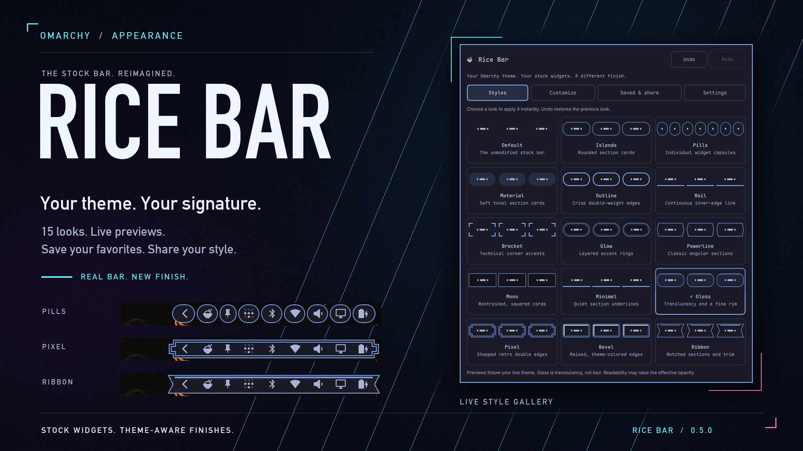
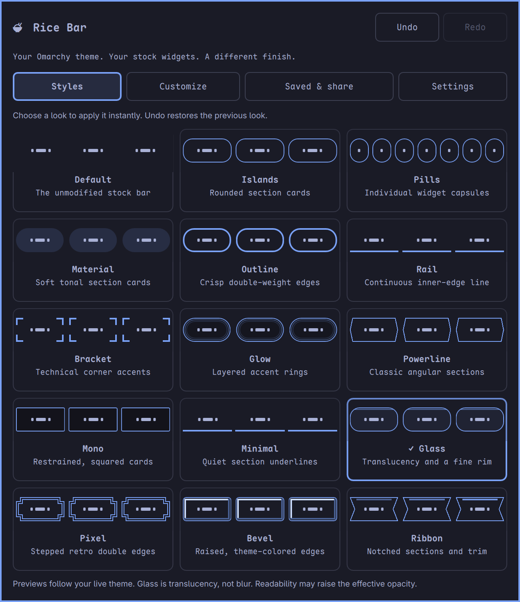
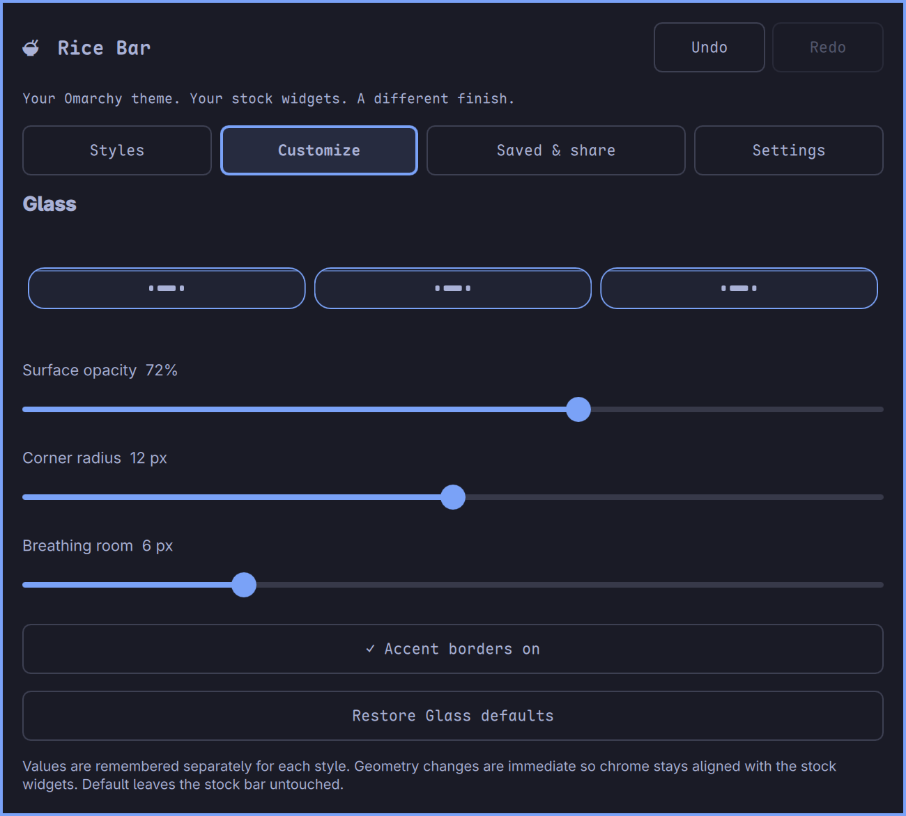
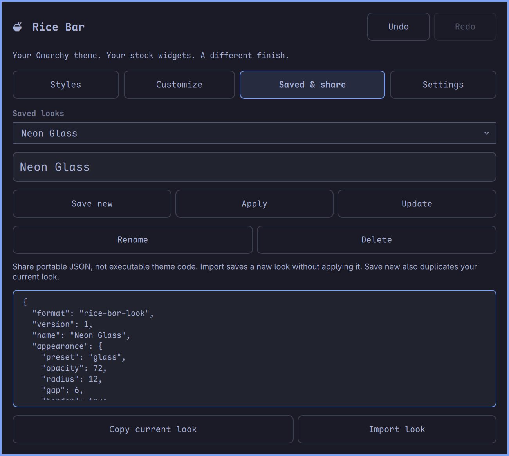
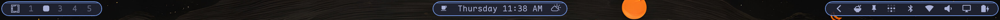
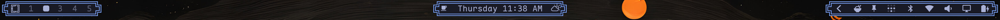
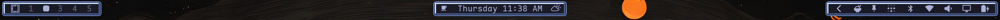
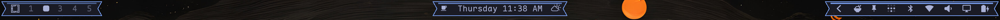
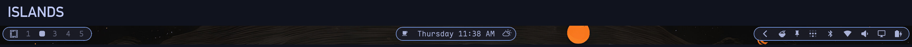

# Rice Bar

[](https://x.com/scottito22)

**A live style gallery for the stock Omarchy Quattro bar.**



> Own the chrome, not the widgets.

Rice Bar keeps `omarchy.bar` and its real widgets. It paints non-interactive decoration inside the **existing stock bar window**—not a replacement bar, a copied widget collection, or a second shell. Stock text colors, click targets, panels, spacing, and drag handling remain Omarchy's responsibility.

## Styles

Choose a card to apply it immediately. **Undo** brings back the previous look.

| Style | Finish |
|---|---|
| Default | Unmodified stock bar; no Rice Bar decoration |
| Islands | Rounded section cards; the default Rice Bar preset |
| Pills | Individual widget capsules, including visible tray leaves |
| Material | Soft tonal cards |
| Outline | Crisp double-weight edges |
| Rail | Continuous inner-edge line with section backplates |
| Bracket | Technical corner accents |
| Glow | Layered accent rings |
| Powerline | Classic angular sections |
| Mono | Restrained squared cards |
| Minimal | Quiet section underlines |
| **Glass** | Translucency and a fine rim; **not compositor blur** |
| **Pixel** | Stepped retro double edges |
| **Bevel** | Raised, theme-colored edges |
| **Ribbon** | Notched sections and trim |

The gallery and live bar use the same decoration renderer. Colors follow the current Omarchy theme; visible accents follow its active-window border. No separate color scheme is installed. Geometry and opacity may be constrained to keep the existing text readable; effective opacity can be higher than the selected intensity.

### Native gallery and controls



| Customize each style | Save and share your looks |
|---|---|
|  |  |

[Settings and diagnostics](examples/settings.png) · [Full-resolution gallery](examples/gallery.png)

### Native bar examples

These are fresh cropped captures from a real Omarchy desktop, not substitute widgets. The gallery and bar use the Tokyo Night palette; the light-theme example uses Catppuccin Latte. The promotional cover frames actual screenshots in original artwork.

| Glass | Pixel |
|---|---|
|  |  |

| Bevel | Ribbon |
|---|---|
|  |  |

The existing styles also have captures in [`examples/`](examples/).



The loop above is assembled from native captures of the same bar and wallpaper, not a recording of animation timing. Additional evidence: [light-theme Glass](examples/light-glass.png) and [vertical Pills](examples/vertical-pills.png).

## Install and open

```bash
omarchy plugin add https://github.com/jcarcinogen/omarchy-rice-bar.git --enable --yes
```

Click the rice-bowl button on the right of the bar. The gallery has four tabs:

- **Styles:** visual previews, immediate selection, Undo/Redo.
- **Customize:** opacity, corner radius, breathing room, accent borders, and selected-style reset. Customizations are remembered separately for every style.
- **Saved & share:** save, apply, update, rename, delete, copy, and import portable looks. Import saves a look without applying it. Save new can duplicate the current appearance.
- **Settings:** reduced motion, icon visibility, an optional menu shortcut, theme-palette links, and runtime diagnostics.

Tab moves between controls. Enter/Space activates buttons and style cards; arrow keys adjust focused sliders. Escape closes the panel even from its text editor.

### Hide the icon without losing access

Use **Settings → Add menu shortcut**, then optionally hide the rice-bowl icon. Open with **Super+Space → Rice Bar**, or:

```bash
omarchy-shell rice-bar open
```

The hidden bar entry must stay installed: it owns the stock-window decoration. Adding the menu shortcut is explicit, not an install hook. Its helper uses Python's standard library, preserves unrelated JSONC/comments, and refuses to overwrite user-owned or edited Rice Bar entries. **Remove shortcut** removes only the exact owned row.

### Saved looks and palette links

Portable look JSON contains only a name and validated appearance values—no commands, file paths, remote images, or executable theme code. Imports are limited to 32 KiB; there are up to 32 saved looks and 32 palette links. Names are limited to 48 characters.

**Link current look** associates the current appearance with the theme's color palette and enables following. Returning to that palette restores the linked look. Unlinked palettes keep the current appearance. Themes with identical colors share a link; this is not theme-name matching.

Appearance settings, saved looks, and links stay inline on Rice Bar's `shell.json` entry. Undo/Redo is session-local and bounded; it resets on shell restart. The optional menu row is the only separate user configuration edited by Rice Bar.

## Stock behavior and compatibility

Version 0.5.0 was exercised on **Omarchy 4.0.4-1 / Quickshell 0.3.1-1**, with all four edges, a live light palette, the original dark palette, and two outputs including fractional scaling. Older host versions have not been revalidated with this adapter.

The adapter reads the stock slot tree with depth/node limits; it never reparents widgets or writes private slot APIs. A reversible Qt binding clears only the existing window background while Rice Bar actually paints. Default, stock transparency, hiding, or missing geometry stops decoration and restores native background behavior. Disabling/removing the plugin also releases that binding.

Omarchy's transparency toggle **pauses** Rice Bar instead of fighting it. Rice Bar does not change stock text colors, input handlers, widget order, exclusive zones, or panel routing. Theme colors too close to the native foreground receive a safer backplate; contrast calculations account conservatively for wallpaper compositing.

The adapter depends on Omarchy's internal visual slot structure because 4.0.4 does not expose a public geometry API. Future host changes can require an adapter update. Diagnose the actual paint state—not just the selected style—with:

```bash
omarchy-shell rice-bar status
omarchy-shell rice-bar settings
omarchy-shell rice-bar style glass
omarchy-shell rice-bar style omarchy
omarchy-shell rice-bar undo
omarchy-shell rice-bar redo
```

`status` reports per-display geometry, painted surfaces, contrast, and reasons such as `stock-style`, `stock-transparency`, `bar-hidden`, or `geometry-unavailable`.

**Known host limitation:** on the tested desktop, dragging the bar out toward another screen edge can fail even with Rice Bar fully disabled. Use the Omarchy menu to change its position. Double-clicking empty bar space toggles transparency normally. Rice Bar leaves these stock input handlers unchanged.

The release acceptance contract is the official [Omarchy Top Bar manual](https://omarchy.org/manual/the-top-bar). See [`REVIEW.md`](REVIEW.md) for measured evidence and limits, and [`CHANGELOG.md`](CHANGELOG.md) for release changes. Automated testing is not a guarantee of zero bugs.

## Development

```bash
node --test tests/*.test.js
python3 -B -m unittest discover -s tests -p 'test_*.py'
omarchy plugin validate .
```

The installed directory is `~/.config/omarchy/plugins/io.github.jcarcinogen.rice-bar/`. After QML changes:

```bash
omarchy-shell shell rescanPlugins
omarchy-restart-shell
```

Do **not** use `omarchy-refresh-shell`; it replaces the user's shell configuration with shipped defaults. `qmllint` is useful but can report unresolved host types: actual plugin loading, clicks, layer cleanup, and logs must also be checked.

## Uninstall

Remove an optional menu shortcut before removing the plugin:

```bash
python3 ~/.config/omarchy/plugins/io.github.jcarcinogen.rice-bar/scripts/menu-access.py remove
omarchy plugin remove io.github.jcarcinogen.rice-bar
```

Select **Default** for a quick non-destructive return to the stock appearance. No extra packages or host-source changes are required. The optional menu shortcut uses Python 3 from the standard Omarchy installation. No sudo or pkexec is required.

## License

MIT — see [LICENSE](LICENSE).
